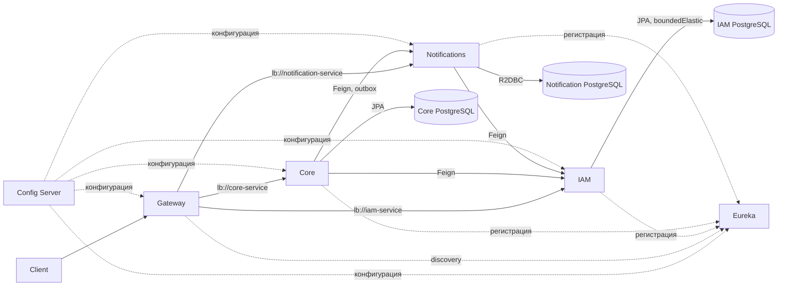

# Архитектура лабораторной №2

## Границы сервисов

IAM владеет пользователями и ролями. Остальные сервисы получают активного пользователя через внутренний HTTP-контракт. Они не читают таблицы IAM и хранят только UUID пользователя.

Core объединяет связанные сценарии персон, импорта, генерации ответов, диалогов, консультаций и модерации. Их прежние транзакции и события остаются внутри процесса. Сервис уведомлений владеет историей доставки и имеет собственную БД.

Модули `shared-kernel` и `shared-web` содержат контракты и техническую инфраструктуру; бизнес-сервисы не зависят от исполняемых модулей друг друга.

## Реактивность и транзакции

IAM использует Reactor и Spring Data JPA. Контроллеры создают ленивые `Mono`, а вызовы JPA выполняются на `boundedElastic`. Транзакционный прокси открывает транзакцию уже в рабочем потоке. Hibernate-сущности преобразуются в HTTP DTO до завершения операции; Open Session in View отключён.

Сервис уведомлений использует WebFlux и Spring Data R2DBC: запросы к PostgreSQL возвращают `Mono` и `Flux`. Только синхронный Feign-клиент IAM вынесен на `boundedElastic`.

## Надёжность

`NotificationEventListeners` работает в фазе `BEFORE_COMMIT`. Запись outbox и бизнес-изменения коммитятся или откатываются вместе. Обработчик выбирает записи с `FOR UPDATE SKIP LOCKED`, отправляет их по Feign и удаляет после подтверждения. При недоступности сервиса запись остаётся в БД до следующей попытки.

Сбой между доставкой и удалением outbox приводит к повторному запросу с тем же UUID. Уникальный ключ в сервисе уведомлений и `ON CONFLICT DO NOTHING` обеспечивают одну запись на событие. После перезапуска очередь продолжает обрабатываться.

Resilience4j ограничивает вызовы недоступных зависимостей. Gateway использует реактивный Circuit Breaker, OpenFeign — Spring Cloud Circuit Breaker. Ошибка зависимости возвращается как HTTP 503, отсутствие пользователя — как HTTP 401. Отказ IAM не превращается в разрешение доступа.

## Конфигурация и запуск

Config Server читает native-репозиторий `config-repository`. Клиенты используют обязательный `configserver:` import: запуск с потерянной конфигурацией завершается ошибкой. Адрес Config Server передаётся до обращения к Eureka, что исключает циклическую зависимость при запуске.

Eureka получает конфигурацию из Config Server. Бизнес-сервисы и Gateway регистрируются в Eureka и используют сервисные имена вместо фиксированных URL.

Compose ожидает готовность Config Server, Eureka и соответствующих баз. HTTP-порты бизнес-сервисов не публикуются на хост; Gateway пропускает публичные API и WebSocket, но не `/internal/**`.
